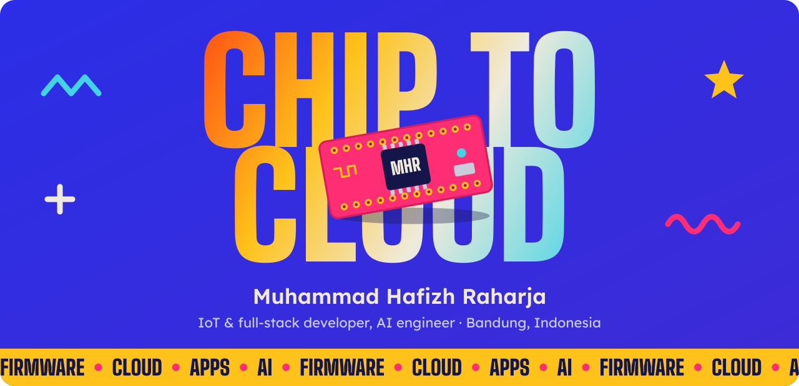
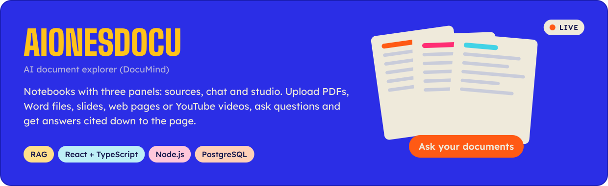
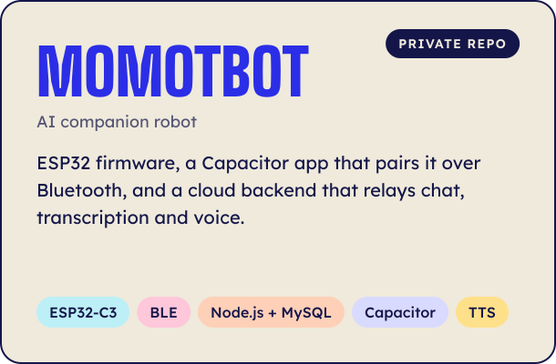
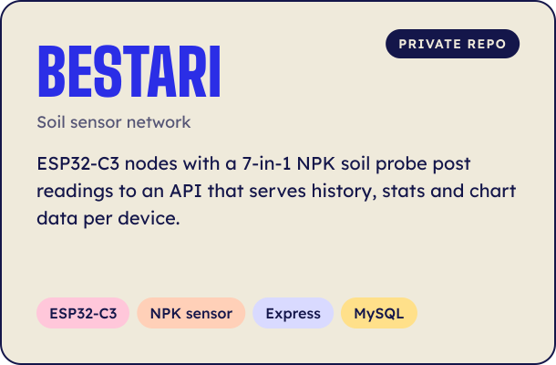
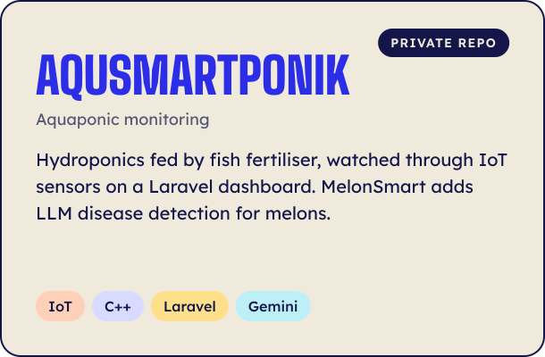
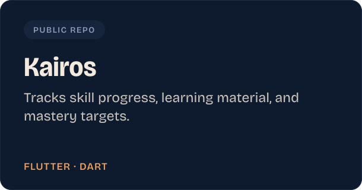
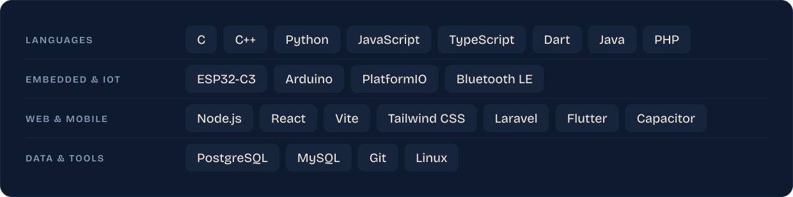
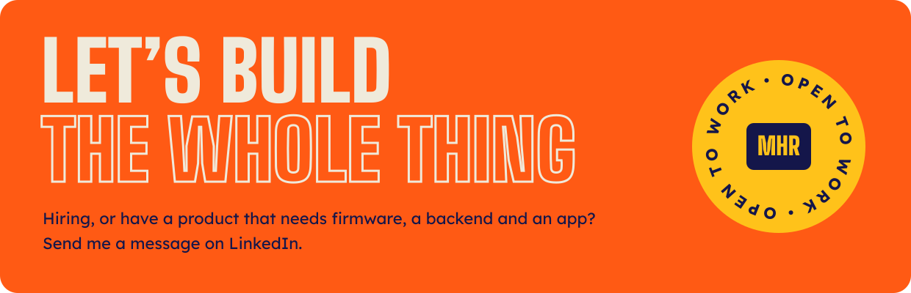

  <b>Open to work and freelance projects.</b>
    
  
  
  

## About

I'm Hafizh, based in Bandung. I write the firmware on the device, the API it reports to, the app people hold and the AI behind it, for the same product.

Hardware products break at the seams between firmware, backend and app. I work on every side of those seams, so the board, the server and the screen get designed together. I study Information Systems at Telkom University.

Now building **MomotBot**, an AI companion robot that talks back, and **AionesDocu**, which answers questions across a pile of documents.

## Built. Shipped.

&nbsp;
&nbsp;

Also: Komunitas Halal Bandung bookkeeping, client portfolio sites and coursework, mostly in private repos.

## Stack

## Activity

Most of my commits go to private repos, so this chart shows only part of the work.

  
  

## Contact

  
  
  
    
  

